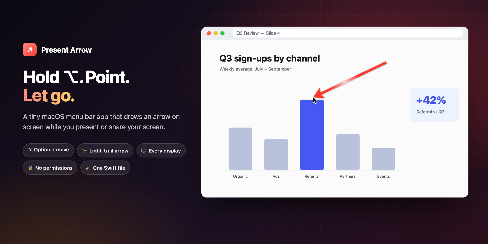
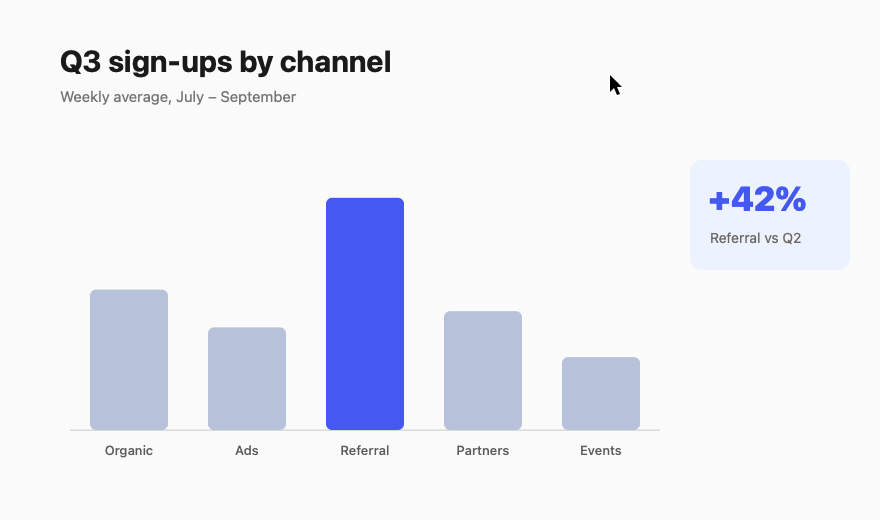

<div align="center">



# Present Arrow

**Hold ⌥ Option, move the mouse, and a big arrow points at whatever you're talking about.**
Let go of Option and it's gone. Made for presenting and screen sharing on macOS.

[](LICENSE)


[What you get](#-what-you-get) · [See it in action](#-see-it-in-action) · [Install](#-install) · [How it works](#-how-it-works)

</div>

## ✨ What you get

| Feature | What it does |
|---|---|
| ⌥ **Hold to point** | Press Option where you want the tail. The arrow head follows your cursor until you let go. |
| 🖱 **No clicking** | You only move the mouse, so nothing is dragged or selected in the app underneath. |
| ✨ **Light trail** | A soft band of light runs from tail to head on a loop (about 1.6 s per pass), so viewers can tell which way it points. |
| 🎨 **6 colors, 4 sizes** | Red, Yellow, Green, Blue, Pink, White. Thin, Medium, Thick, Huge. Pick them from the menu bar. |
| 🖥 **Every display** | Works on every connected screen, every Space, and over full-screen apps. Viewers see it when you share your screen. |
| 🙅 **Stays out of the way** | Click-through overlay. Ignores ⌥ combined with ⌘ ⌃ ⇧, and waits until the mouse moves 12 pt, so typing ⌥ characters won't flash an arrow. |
| 🔒 **No permissions** | No Accessibility or Input Monitoring prompt: the app only reads the modifier state and cursor position. |
| 🚀 **Open at Login** | One click in the menu. |
| 🪶 **Tiny** | One Swift file (~320 lines), no dependencies, no Xcode project. |

## 🎬 See it in action

<div align="center">

</div>

<sub>Rendered with the app's own arrow-drawing code over a sample slide. The ⌥ badge shows when Option is held; the real app doesn't show it.</sub>

## 🤔 Present Arrow or something else?

| You want… | Use |
|---|---|
| One quick arrow while you talk, with zero setup | **Present Arrow** |
| Freehand drawing, shapes, text, spotlight or zoom | A full screen-annotation app |
| Viewers to just find your cursor | macOS **Shake mouse pointer to locate** or a bigger pointer in System Settings → Accessibility → Display |

Present Arrow does one thing only. It doesn't draw, highlight or zoom, and it isn't signed or notarized by Apple (you build it yourself).

## 📦 Install

You need macOS 13 or later and the Xcode Command Line Tools (`xcode-select --install`).

```bash
git clone https://github.com/tlejay/present-arrow.git
cd present-arrow
./build.sh install   # builds, copies to /Applications, launches
```

An arrow icon shows up in the menu bar. That's it.

- `./build.sh` only builds to `build/Present Arrow.app`.
- To uninstall, choose **Quit Present Arrow** from the menu and delete `/Applications/Present Arrow.app`.

## 🛠 How it works

- **Input:** a 120 Hz timer reads `NSEvent.modifierFlags` and `NSEvent.mouseLocation`. Reading them doesn't need any privacy permission, unlike global key event taps.
- **Overlay:** one borderless, transparent, click-through `NSWindow` per screen at `.screenSaver` level, joined to all Spaces.
- **Arrow:** a single `CGPath` (shaft + head) filled by a `CAGradientLayer`. The gradient axis runs tail → head, and its color stops slide along it to make the light trail. A plain shape layer underneath adds the drop shadow.
- **Settings:** stored in `UserDefaults` (`com.madebytle.presentarrow`). Open at Login uses `SMAppService`.

```
Sources/main.swift   the whole app
build.sh             swiftc → .app bundle, ad-hoc signed
docs/                README images
```

## Contributing

Issues and pull requests are welcome. Please keep it to one file and no dependencies.

## License

[MIT](LICENSE)

<div align="center">

If Present Arrow helps your next demo, a ⭐ helps other people find it.

</div>
